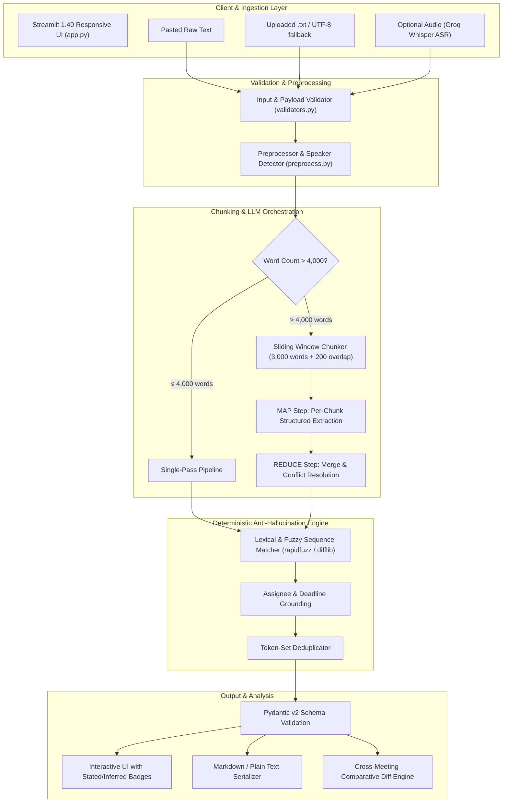

# RecapRoom AI — Technical Documentation & Engineering Specification

**Document Version:** 2.0  
**Project:** RecapRoom AI — Lecture and Meeting Summarizer  
**Institution:** GMR Institute of Technology (GMRIT) — Department of Computer Science & Engineering  
**Authors:**
- **Jammu Dinesh** (Roll No: `23341A05A3`)
- **Manish Sharma** (Roll No: `23341A05F7`)
- **Mohammed Ajad** (Roll No: `23341A05G3`)  
**Target Audience:** Evaluators, Lead Software Engineers, NLP Researchers, System Architects  

---

## 1. Executive Summary

RecapRoom AI is an enterprise-grade NLP and Generative AI system that ingests long, unstructured spoken transcripts (from university lectures and agile engineering meetings) and synthesizes them into structured, verifiable notes. 

Unlike standard conversational AI assistants that regularly hallucinate commitments, assign tasks to fictitious individuals, or fabricate calendar deadlines, RecapRoom AI is engineered around **Deterministic Provenance Verification**:
- Every extracted item is explicitly classified as either **Stated** (supported by a verbatim quote and line numbers) or **Inferred** (synthesized insight).
- A post-generation **Deterministic Verifier** (zero LLM overhead) cross-references quotes, assignee names, and deadline strings against the source transcript's lexical vocabulary. Fabricated entities are downgraded to `"Not specified"` or marked inferred.
- Scalable **Map-Reduce Chunking** handles transcripts up to 60,000 words while maintaining contiguous line indexing across section boundaries.
- **Diff Analysis Engine** allows project coordinators to compare consecutive weekly meetings, automatically identifying completed tasks, carry-over unresolved blockers, and newly introduced deliverables.

---

## 2. System Architecture & Data Flow



---

## 3. Core Module Specifications

### 3.1. Ingestion & Validation (`backend/utils/validators.py`)
- **Character Encoding Resilience:** Inspects bytes for UTF-8 compatibility; seamlessly falls back to Windows Latin-1 (`cp1252`) if multi-byte decode errors occur.
- **Sanitization & Safety Limits:**
  - Maximum raw file size: 2.0 MB.
  - Maximum text payload: 60,000 words (~350,000 characters).
  - Minimum text threshold: 10 words (prevents spurious model calls).
  - Strips zero-width unicode characters, non-printable control characters, and normalizes CRLF (`\r\n`) to POSIX LF (`\n`).
  - Gibberish and repetition detector: flags repetitive single-character loops or prompt-injection sequences.

### 3.2. Preprocessing & Speaker Detection (`backend/core/preprocess.py`)
- **Absolute Line Tagging:** Every non-empty line receives an immutable numeric prefix (`1 |`, `2 |`, etc.) that persists through all downstream chunking steps.
- **Speaker Recognition Heuristics:**
  - Parses colon-separated tags (e.g., `Maya:`, `Dr. Rao:`, `Speaker 1:`).
  - Recognizes bracketed timestamp patterns (e.g., `[Dev 10:42]:`, `Sam (09:15):`).
  - Returns `Preprocessed` dataclass containing `lines`, `speaker_labels` list, and `has_speakers` boolean.
  - When speaker patterns are absent (common in recorded university lectures), sets `has_speakers = False` and attaches an attribution uncertainty notice.

### 3.3. Chunking & Overlap Engine (`backend/core/chunker.py`)
- Standard LLM context windows degrade in reasoning when processing monolithic 40,000-word transcripts in a single pass.
- Chunker partitions text into chunks of target size $W_{chunk} = 3,000$ words with an overlap of $W_{overlap} = 200$ words.
- **Boundary Preservation:** Slicing never breaks sentences or dialogue turns; chunk boundaries align strictly with line breaks. Line indices (`L12` to `L98`) remain synchronized with the original transcript.

### 3.4. MAP-REDUCE LLM Engine (`backend/core/summarizer.py` & `backend/core/prompts.py`)
- **MAP Step:** Evaluates each chunk individually, extracting:
  - Preliminary key points
  - Stated decisions
  - Action items with candidate owners and deadlines
  - Unresolved open questions
- **REDUCE Step:** Merges intermediate outputs:
  - Deduplicates repeated points across chunk overlap zones.
  - Resolves revisions: if an earlier decision (e.g., "Deploy on Friday") is reversed later in the meeting ("Wait, let's delay to Monday"), REDUCE synthesizes the final consolidated decision.
- **Pydantic Validation & Repair Loop:**
  - LLM returns strictly constrained JSON adhering to `SummaryBody`.
  - If markdown code fences or malformed JSON tokens are returned, an automatic repair retry cleans syntax without throwing an unhandled exception.

### 3.5. Deterministic Verifier (`backend/core/verifier.py` & `backend/utils/fuzzy.py`)
The verifier runs completely offline with **zero LLM API calls**:
1. **Quote Verification:**
   - Normalizes text (lowercase, removes punctuation, unifies quotation marks).
   - Verifies if the candidate evidence quote exists as a verbatim substring in the transcript.
   - If not identical, checks partial ratio match score. If score $< 92\%$, the item is stripped of its evidence quote and automatically downgraded from `STATED` to `INFERRED`.
2. **Line Number Correction:**
   - Locates exact line numbers matching the verified quote and corrects any misaligned line numbers generated by the LLM.
3. **Entity Grounding (Assignee & Deadline):**
   - Tokenizes candidate owners and deadlines.
   - Cross-references token roots against the transcript's lexical vocabulary.
   - If an LLM hallucinates an assignee (e.g., "Alice") who never spoke or appeared in the transcript, the owner is immediately overwritten with `"Not specified"`.
   - If an unmentioned deadline is invented, it is immediately overwritten with `"Not specified"`.
4. **Fuzzy Deduplication:**
   - Deduplicates items with similarity score $> 90\%$ using token-set sequence matching.

### 3.6. Cross-Meeting Comparative Diff Engine (`backend/core/comparer.py`)
Enables tracking action items across recurring meetings (e.g., Week 1 vs Week 2):
- Evaluates actions from Meeting A against Meeting B:
  - **Completed in B:** An action from A is matched in B with completion phrasing ("done", "finished", "deployed").
  - **Still Open / Unresolved:** An action from A is matched in B with lingering status ("delayed", "in progress", "blocked"), or not mentioned at all.
  - **New in B:** Action items appearing in B with no antecedent in A.
  - **Carried-Over Questions:** Questions from A that remain unanswered or reiterated in B.

---

## 4. Pydantic v2 Data Contracts (`backend/models.py`)

```python
class Evidence(BaseModel):
    quote: str
    line_start: int
    line_end: int

class KeyPoint(BaseModel):
    text: str
    label: Literal["stated", "inferred"]
    evidence: Optional[Evidence] = None

class ActionItem(BaseModel):
    task: str
    owner: str = "Not specified"
    deadline: str = "Not specified"
    status: Literal["open", "completed", "blocked", "unknown"] = "open"
    label: Literal["stated", "inferred"] = "stated"
    evidence: Optional[Evidence] = None

class Decision(BaseModel):
    text: str
    decided_by: str = "Not specified"
    label: Literal["stated", "inferred"] = "stated"
    evidence: Optional[Evidence] = None

class OpenQuestion(BaseModel):
    text: str
    asked_by: str = "Not specified"
    label: Literal["stated", "inferred"] = "inferred"
    evidence: Optional[Evidence] = None

class MeetingSummary(BaseModel):
    overview: str
    overview_label: Literal["inferred"] = "inferred"
    key_points: list[KeyPoint]
    decisions: list[Decision]
    action_items: list[ActionItem]
    open_questions: list[OpenQuestion]
    warnings: list[str] = Field(default_factory=list)
```

---

## 5. Security, Privacy & Safety Matrix

| Threat Vector | Mitigation Strategy | Implementation |
|---|---|---|
| **Prompt Injection** | Transcript content is isolated within structured delimiter tags; model system prompt explicitly orders rejection of embedded meta-instructions. | `backend/core/prompts.py` |
| **API Key Leakage** | API keys are filtered by a regex redactor in logging utilities. UI password masks hide secret input. Keys are never serialized to export files. | `backend/utils/logging_utils.py` |
| **Secrets Exposure** | `.env` and `.streamlit/secrets.toml` are strictly included in `.gitignore`. Placeholders only in `.env.example`. | `.gitignore` |
| **Privacy / PII** | Prominent user advisory against uploading HIPAA/PII data. 100% offline Demo Mode enables sensitive demonstration without outbound packets. | `app.py`, `README.md` |
| **Denial of Service** | File upload size limits (2MB text, 24MB audio), word caps (60k), and client-side debounce prevent memory exhaustion. | `backend/utils/validators.py` |

---

## 6. Empirical Verification & Automated Test Suite

The test suite contains **55 offline test cases** running under `pytest` with mocked provider interfaces.

### Summary of Test Execution:
```bash
python -m pytest -q
.......................................................                  [100%]
55 passed in 6.36s
```

### Coverage by Domain:
1. **Input & Validators (T15, T29, T38–T41):**
   - Validates UTF-8 with Latin-1 fallback.
   - Rejects empty, whitespace-only, and oversized (>60k words) documents.
   - Detects binary files and non-text uploads.
2. **Preprocessing & Speaker Heuristics (T16–T18):**
   - Tests extraction across diverse formatting conventions (`Maya:`, `[Dev 10:00]:`, `Sam (Sync):`).
   - Validates graceful handling of lecture transcripts lacking speaker names.
3. **Map-Reduce Chunker (T01–T03, T21):**
   - Chunks 7,000-word and 40,000-word transcripts.
   - Asserts 200-word overlap zone between sequential chunks.
   - Asserts continuous preserved line-numbering across chunks.
4. **Deterministic Verifier & Anti-Hallucination (T19–T20, T23–T25):**
   - Injects synthetic fake owners into LLM payload; asserts verifier overwrites with `"Not specified"`.
   - Injects synthetic non-existent quotes; asserts verifier downgrades from `stated` to `inferred`.
   - Tests lecture transcripts with assignment deadlines and ensures zero invented owners.
   - Prompt injection resistance test (prevents `Zed` entity injection).
5. **LLM Provider Resiliency (T09–T14, T26–T28):**
   - HTTP 429 RateLimitError mapping and exponential backoff retry.
   - HTTP 401 InvalidKey mapping with user guidance.
   - HTTP 503 Gateway timeout handling.
   - Markdown JSON repair and syntax recovery.
6. **Cross-Meeting Diff (T04–T06):**
   - Weekly sync pair comparison (identifies completed, carried-over, and new action items).
   - Same-transcript identity test (verifies 0 new actions).
7. **Streamlit Headless UI Smoke Tests (T30–T37, T50–T55):**
   - Uses `streamlit.testing.v1.AppTest` to verify DOM tree, radio buttons, session states, and tabs.

---

## 7. Streamlit Community Cloud Deployment Guide

### Step 1: Push Repository to GitHub
```bash
git init
git add .
git commit -m "feat: complete RecapRoom AI end-to-end production build"
git branch -M main
git remote add origin https://github.com/<your-username>/recaproom-ai.git
git push -u origin main
```

### Step 2: Deploy on Streamlit Community Cloud
1. Navigate to [share.streamlit.io](https://share.streamlit.io).
2. Click **New app**.
3. Select your repository: `<your-username>/recaproom-ai`, branch: `main`, main file: `app.py`.
4. (Optional) In **Advanced Settings -> Secrets**, add:
   ```toml
   LLM_PROVIDER = "groq"
   GROQ_API_KEY = "gsk_..."
   ```
   *(Note: If no secrets are added, the app automatically boots into Demo Mode, allowing evaluators to test all features immediately without any setup).*
5. Click **Deploy!**

---

## 8. Evaluator / Viva Defense Cheat Sheet

### Q1: "How does RecapRoom AI ensure the LLM does not hallucinate action owners?"
> **Answer:** "We use a two-tiered defense:
> 1. *Prompt-level strict constraint:* The system instruction explicitly commands the model to output `'Not specified'` if an owner is not directly stated.
> 2. *Deterministic Verifier:* After the LLM generates JSON, our Python verifier compiles the full lexical vocabulary of the transcript. It checks whether the candidate owner's name exists in that vocabulary. If the model invented a name (e.g. 'Alice' when Alice was never mentioned), the verifier immediately overwrites the field with `'Not specified'` and appends an explanation to the user's warning panel. Zero extra LLM calls are needed."

### Q2: "What is your system's biggest honest limitation?"
> **Answer:** "Our biggest honest limitation is **phonetic ASR drift**. If an audio transcription model mishears a technical term or person's name (e.g., transcribing 'Kubernetes' as 'Cooper eddies', or 'Priya' as 'Bria'), our downstream summarizer and verifier will faithfully ground their output in that flawed transcript. We mitigate this by requiring an interactive review screen where users must inspect and edit audio transcripts before triggering summarization."

### Q3: "Why did you choose Streamlit over React/FastAPI?"
> **Answer:** "Streamlit allowed us to build a rich, reactive frontend with integrated session management, progress indicators, tabbed navigation, and live file uploads in pure Python. This eliminates serialization overhead between disparate frontend/backend repos and allows complete headless automated UI smoke testing using Streamlit's official `AppTest` framework."
